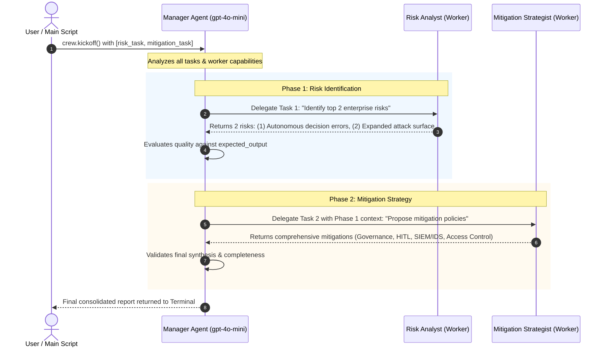

# Hierarchical Process Architecture & Execution Flow in CrewAI

This document explains the runtime behavior, data flow, and event cycle of the **Hierarchical Process** executed in [`level_1_fundamentals.py`](file:///Volumes/Lexar/GitHub/agentic-ai-101/crewai-demo/level_1_fundamentals.py#L74-L106).

---

## 1. What Happened Behind the Output

In a standard **Sequential Process**, tasks execute in fixed list order ($Task_1 \rightarrow Task_2$), with agents assigned strictly ahead of time.

In contrast, when you set `process=Process.hierarchical`:
1. CrewAI automatically creates an **implicit Manager Agent** powered by `manager_llm="gpt-4o-mini"`.
2. Notice in your code that neither `risk_task` nor `mitigation_task` had an assigned `agent=...` argument.
3. The **Manager Agent took full ownership** of the plan:
   - Read all task descriptions and goals.
   - Evaluated the worker roster (`analyst` and `strategist`).
   - Dynamically routed the task to the best-suited specialist (`Risk Analyst` for Task 1, `Mitigation Strategist` for Task 2).
   - Validated the quality of each worker's response before accepting it or delegating the next step.

---

## 2. Architecture & Data Flow Diagram



---

## 3. Step-by-Step Lifecycle & Events

### Event 1: Crew Initialization & Manager Synthesis
* **Code:**
  ```python
  crew = Crew(
      agents=[analyst, strategist],
      tasks=[risk_task, mitigation_task],
      process=Process.hierarchical,
      manager_llm="gpt-4o-mini",
  )
  ```
* **Event:** CrewAI spins up a supervisor agent with instructions to oversee `analyst` and `strategist`, coordinate sub-goals, and synthesize the ultimate deliverable.

### Event 2: Dynamic Task Delegation (Task 1)
* **Manager's Internal Thought:** 
  > *"I have two tasks. Task 1 requires identifying enterprise risks of tool execution. Looking at my team, `Risk Analyst` specializes in AI red-teaming and safety compliance."*
* **Action:** The manager delegates Task 1 to the **Risk Analyst**.
* **Worker Output:** The analyst produces the two primary risk vectors:
  1. *Autonomous decision-making errors / lack of transparency*
  2. *Security vulnerabilities and attack surface expansion through tool access*

### Event 3: Evaluation & Context Hand-off (Task 2)
* **Manager's Evaluation:** The manager reviews the analyst's output, marks Task 1 satisfied, and takes the identified risks as context for Task 2.
* **Delegation to Strategist:** The manager instructs the **Mitigation Strategist**:
  > *"Here are the risks identified. Formulate policies and technical safeguards for them."*

### Event 4: Specialized Solution Formulation
* **Strategist Response:** Formulates specific, actionable mitigations corresponding directly to the two identified risks:
  * For Risk 1: Human-in-the-loop (HITL), real-time compliance audits, and explainability monitors.
  * For Risk 2: RBAC/MFA, network segmentation, IDS/SIEM intrusion monitoring, and continuous vulnerability patching.

### Event 5: Final Review & Synthesis
* The Manager evaluates the final output against `expected_output="Two mitigation strategies corresponding to the risks."`
* Because quality criteria are satisfied, the Manager returns the finalized response to the terminal without requiring another iteration.

---

## 4. Key Differences: Sequential vs Hierarchical

| Feature | `Process.sequential` | `Process.hierarchical` |
| :--- | :--- | :--- |
| **Orchestrator** | Pre-defined static pipeline | Dynamic LLM Manager (`manager_llm`) |
| **Task Assignment** | Explicit (`agent=researcher`) | Autonomous delegation by Manager |
| **Context Sharing** | Linear handoff or explicit `context=[...]` | Manager orchestrates and injects relevant context |
| **Error Handling / Review** | Moves forward regardless of depth | Manager can ask for revisions or delegate back |
| **Cost & Latency** | Lower (1 call per agent task) | Higher (extra manager planning & review calls) |

---

## 5. Summary of Terminal Tracing Message

At the end of your run, CrewAI displayed:
```
Info: Tracing is disabled.
To enable tracing, do any one of these:
• Set tracing=True in your Crew/Flow code
• Set CREWAI_TRACING_ENABLED=true in your project's .env file
• Run: crewai traces enable
```
When enabled, CrewAI records every internal manager delegation thought, worker tool call, and latency metric to the CrewAI telemetry dashboard.
